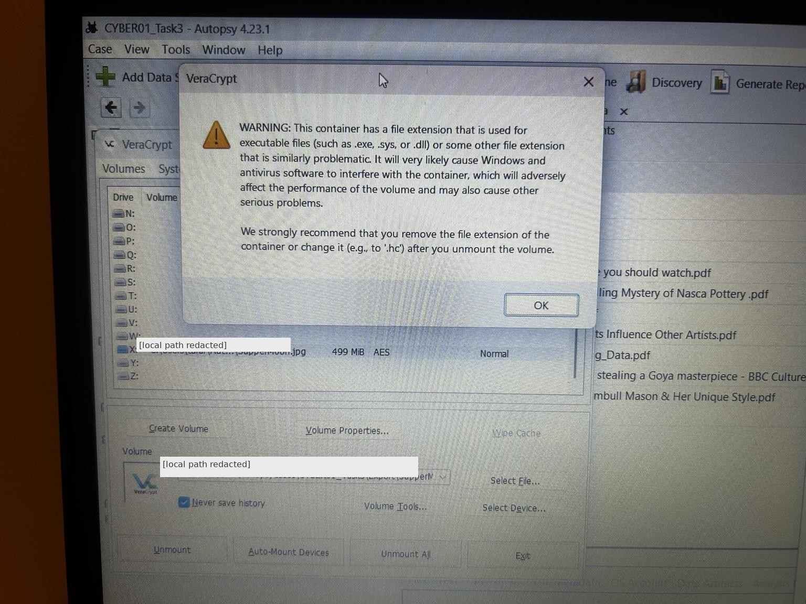
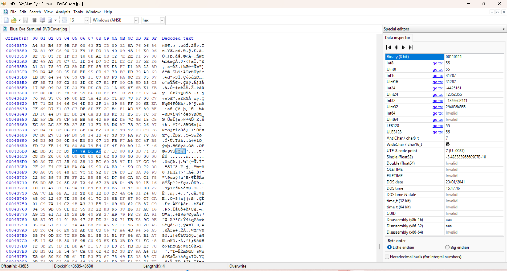

# Digital Forensics Investigation

**[Read the full walkthrough with screenshots](WALKTHROUGH.md)**

I investigated two forensic disk images to see what could be recovered from deleted files, what file headers revealed about files with missing extensions, and whether anything had been deliberately hidden. I used FTK Imager and Autopsy for the initial examination, then VeraCrypt, HxD, 7-Zip and Excel to inspect the material I found.

The work was carried out in a Windows environment. This repository documents the investigation and the results visible in my screenshots. It does not contain the original disk images, recovered documents or an encrypted volume.

## Findings that stood out

### A 500 MiB encrypted volume with a `.jpg` extension

Autopsy flagged `SupperMoon.jpg` as possibly encrypted, with an entropy reading of `8.000000`. After exporting the file, I mounted it in VeraCrypt as drive `X:` and found three original files inside. Its name suggested a photograph, but its behaviour was consistent with a VeraCrypt container.

*VeraCrypt shows the mounted volume on `X:`. The local file path has been redacted.*

### An Excel workbook concealed inside another image

I inspected `Blue_Eye_Samurai_DVDCover.jpg` in HxD and found a 7-Zip archive header beginning at offset `0x436B5`. The recovered archive contained `Movie.xlsx`, which listed 11 entries, territories, contacts and sales figures. Several entries used names also associated with drugs. That made the spreadsheet worth investigating, but it was not enough on its own to prove an offence.

*The highlighted bytes start the `37 7A BC AF 27 1C` 7-Zip signature within the JPG.*

## Other results

- Recovered `london.jpg` from a FAT32 USB image and confirmed its JPEG/JFIF header (`FF D8 FF E0`). Other deleted files were damaged, empty or unreadable, so I did not claim to have verified their signatures.
- Verified the integrity of `CYBER01.E01` in FTK Imager using matching MD5 and SHA1 results, with no bad blocks reported.
- Identified eight extensionless files by inspecting their opening bytes. These included PDF, ZIP, text, HTML, 7-Zip, GIF, MP3 and DOCX formats.
- Interpreted an MP3 header beginning `FF FB 90 44` as MPEG Version 1 Layer III, with a first-frame bitrate index corresponding to 128 kbit/s.
- Examined `income.xlsx`, which showed 21 collectors and a recorded total of £11,362.

## Tools

| Tool | How I used it |
| --- | --- |
| FTK Imager | Inspect FAT32, recover a deleted JPEG, examine hex headers and verify the E01 image |
| Autopsy 4.23.1 | Search documents, review extracted text and identify suspected encrypted data |
| VeraCrypt | Mount the extracted container and inspect its contents |
| Windows PowerShell | Generate a SHA256 hash from filename text |
| HxD | Locate an embedded archive signature in a JPEG |
| 7-Zip | Open the carved archive and inspect its contents |
| Microsoft Excel | Examine the recovered sales spreadsheets |

## Evidence and limitations

The screenshots are from my investigation, with local paths, personal names, contact names and a credential redacted before public sharing. I have kept the original screenshot context where it supports a technical claim.

Two details need care. The FAT32 file count describes the **root directory**, not a complete recursive inventory. Also, the captured PowerShell screenshot and the written report name different SHA256 filename candidates. I have documented the hashing method but cannot verify the exact successful candidate from the public screenshots alone. The recovered spreadsheets suggest questions for further investigation; they do not establish criminal activity by themselves.

**[See each step and its supporting evidence in `WALKTHROUGH.md`](WALKTHROUGH.md).**