# Investigation walkthrough

[Back to the project overview](README.md)

I used a Windows workstation for the tools shown here. The screenshots document what I observed, rather than a scripted reconstruction. I have redacted personal file paths, names and the hash output used as a container credential. No original E01 images or recovered spreadsheets are published.

## 1. Start with the USB forensic image

I began with the USB image `E_01_yasin.E01`, produced during a lab session, and opened it in **FTK Imager 4.7.1.2**. I checked the evidence tree before attempting recovery. FTK Imager showed a FAT32 partition, `USB14`, and the root directory.

The device geometry recorded **7,864,320 sectors of 512 bytes**, giving **4,026,531,840 bytes** (about 4.03 GB or 3.75 GiB). This helped me distinguish the full device capacity from the partition size displayed by FTK Imager. The evidence supplied here does not show the original imaging wizard, so I cannot document every acquisition setting.

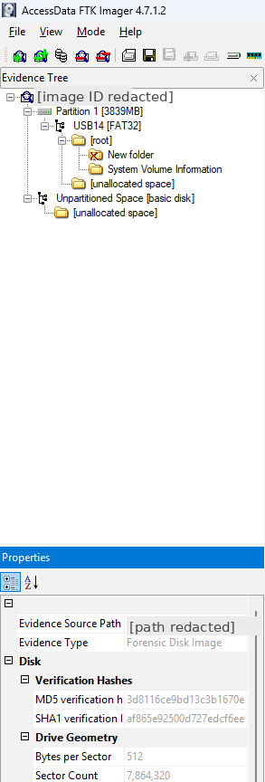

*The evidence tree identifies FAT32. The lower properties pane records the sector size and count.*

I also photographed the physical USB so there was a visual record of the device being examined.

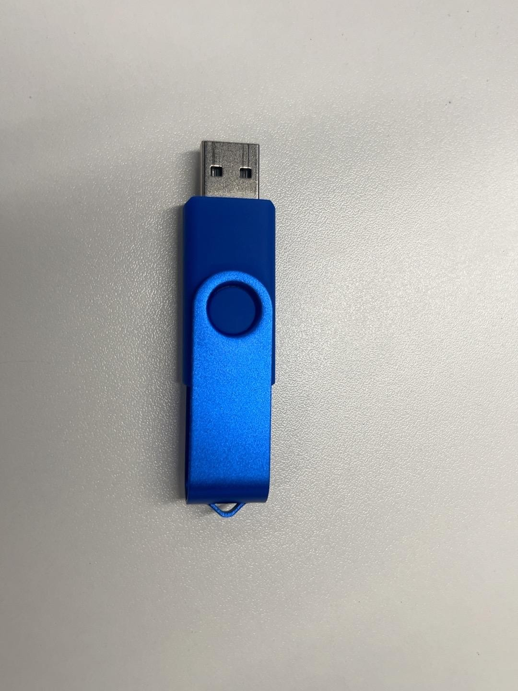

*The blue USB device photographed during the examination.*

## 2. Inspect deleted entries and recover a JPEG

In **FTK Imager**, I opened `Partition 1 > USB14 [FAT32] > [root]`. The root listing contained **15 regular file entries**, of which **12 were marked deleted**, as well as two directories. This is a count of the visible root entries, not a claim about every file inside subfolders.

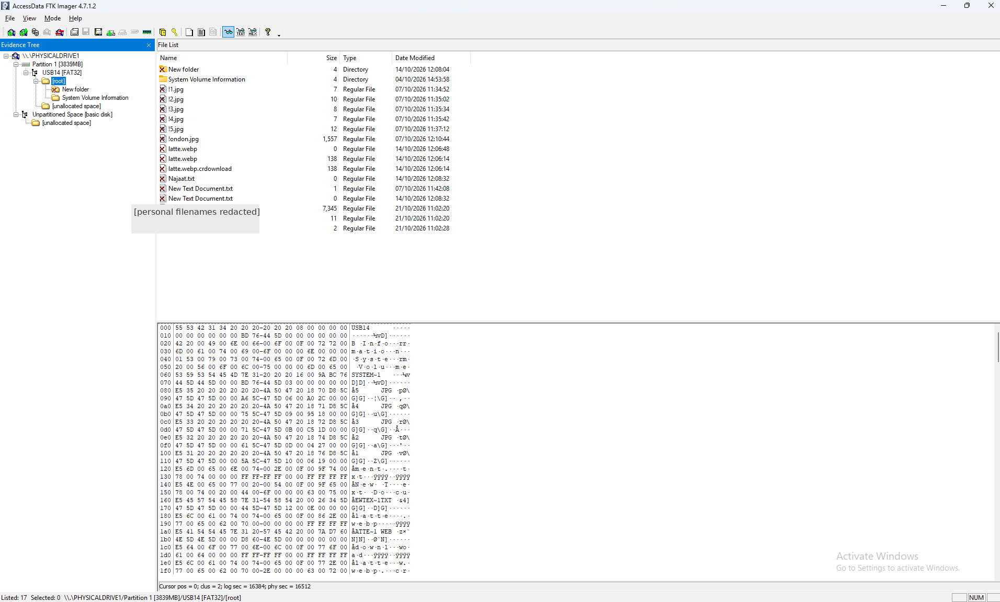

*The red-cross markers indicate deleted entries. Personal filenames in the listing have been redacted.*

I attempted to examine the deleted files. `london.jpg` was the only recovered image I could open and check reliably. The other entries were damaged, empty or unreadable, so I recorded that limitation rather than inventing signatures.

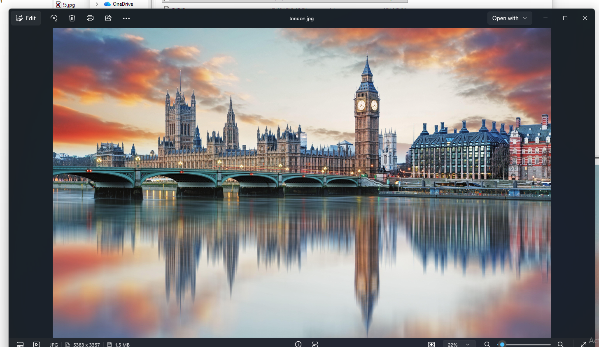

*The recovered JPEG opened successfully in Windows Photos.*

I then inspected `london.jpg` in FTK Imager's hexadecimal view. The first bytes were `FF D8 FF E0`, followed by the `JFIF` identifier. That confirmed a JPEG/JFIF file rather than relying only on the `.jpg` extension.

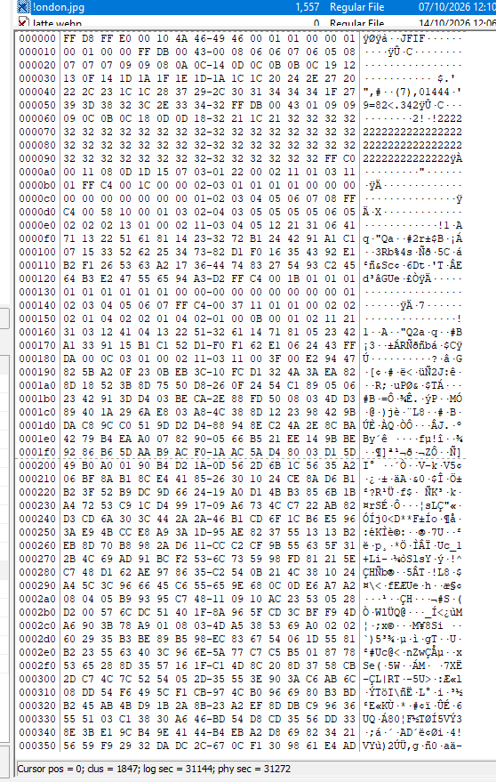

*The file header begins with `FF D8 FF E0` and includes `JFIF`.*

## 3. Verify the second forensic image

For the second part of the investigation, I added **`CYBER01.E01`** to **FTK Imager 8.3.0.27** and used **Verify Drive/Image**. The computed MD5 and SHA1 values matched the stored verification hashes, and the result reported no bad blocks.

This gave me an integrity check for the E01 image at the time of examination. It did not establish who handled the image before I received it.

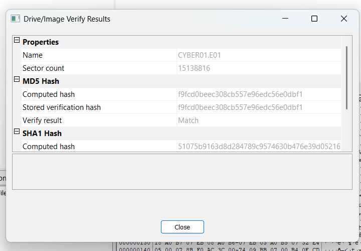

*FTK Imager reports a match between the computed and stored MD5 hashes.*

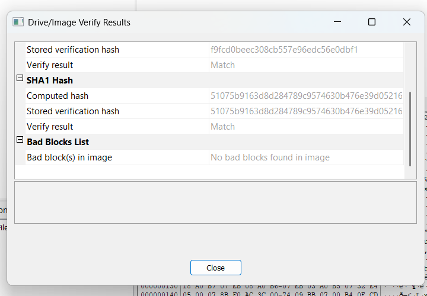

*The SHA1 result also matches, and the bad-block list is empty.*

## 4. Identify files that had no extensions

Still in **FTK Imager on Windows**, I navigated to `CYBER01 > root > private`. I found eight files named `file01` to `file08`. Their names did not identify their formats, so I selected each one and checked the opening bytes in the hexadecimal pane.

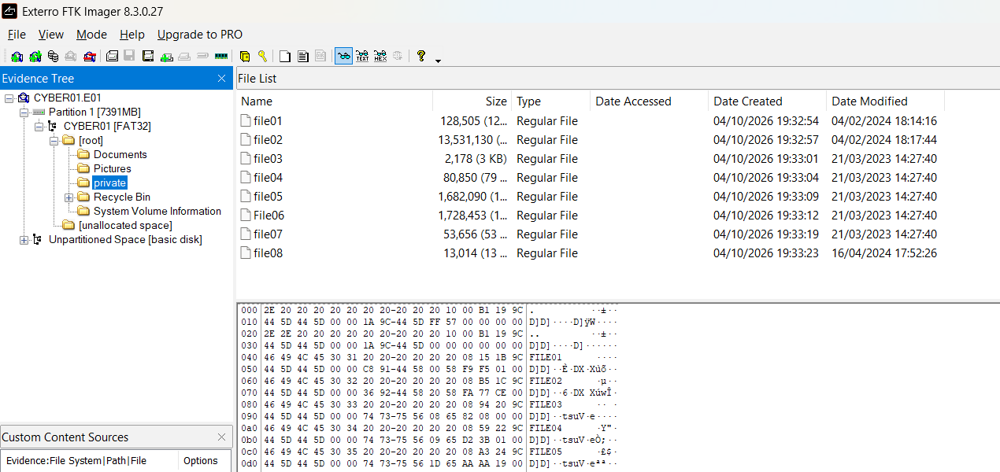

*The `private` directory contains the eight files before their formats were identified.*

| File | Header or identifying content | Format identified |
| --- | --- | --- |
| `file01` | `25 50 44 46 2D` | PDF |
| `file02` | `50 4B 03 04` | ZIP |
| `file03` | Starts with readable text, `Arsenal` | Plain text |
| `file04` | `3C 21 44 4F 43 54 59 50 45` | HTML |
| `file05` | `37 7A BC AF 27 1C` | 7-Zip archive |
| `file06` | `47 49 46 38 39 61` | GIF89a |
| `file07` | `FF FB 90 44` | MP3 |
| `file08` | `50 4B 03 04`, with Word package structure | DOCX |

For example, `file01` begins with the ASCII equivalent of `%PDF-`, which identifies a PDF header.

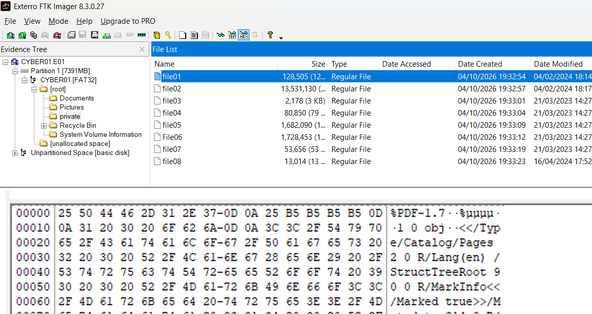

*The first five bytes of `file01` read `25 50 44 46 2D`.*

`file05` begins with the 7-Zip signature, which was useful later when looking for concealed archive data.

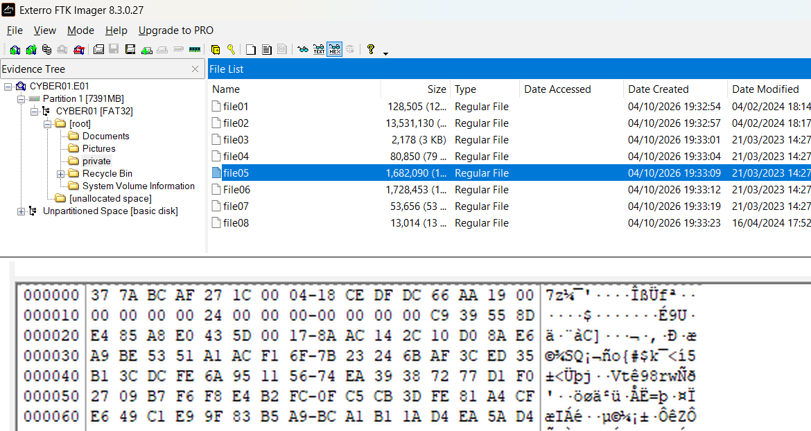

*The bytes at the start of `file05` identify a 7-Zip archive.*

I treated `file08` differently because `50 4B 03 04` is shared by ZIP files and Office Open XML documents. After extraction, its `_rels`, `docProps`, `word` and `[Content_Types]` entries supported the DOCX identification.

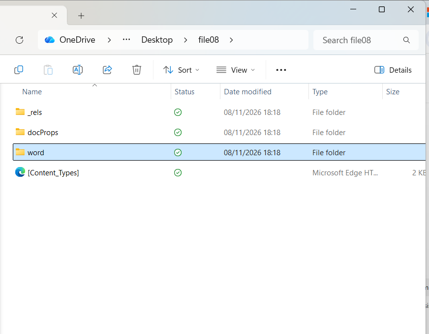

*The `word` folder and `[Content_Types]` file distinguish this package from a generic ZIP archive.*

## 5. Interpret the MP3 header

For `file07`, I read the first four bytes as `FF FB 90 44`. The MPEG version bits indicate **MPEG Version 1**, and the layer bits indicate **Layer III**. The bitrate index is the upper four bits of `90`, which are `1001` in binary. In an MPEG Version 1 Layer III header, that index corresponds to **128 kbit/s for the first frame**.

I also found the `Xing` marker in the data. This is commonly associated with variable-bitrate MP3 files, so I did not treat the first-frame bitrate as proof of a constant rate throughout the file.

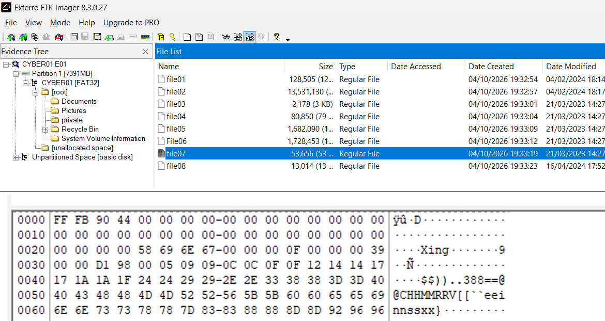

*The hex pane begins `FF FB 90 44`, and `Xing` appears in the decoded text.*

## 6. Search documents in Autopsy

I opened `CYBER01.E01` in **Autopsy 4.23.1** and inspected the FAT32 `Documents` folder. I used a keyword search for `nca` to find references to the **National Crime Agency**.

The extracted PDF text included material about fraud and criminals impersonating NCA officers. One passage referred to **393 reports since April 2018**, compared with **75 in the preceding financial year**. These were references inside documents, not evidence that the documents were issued by the NCA or that the device owner had committed fraud.

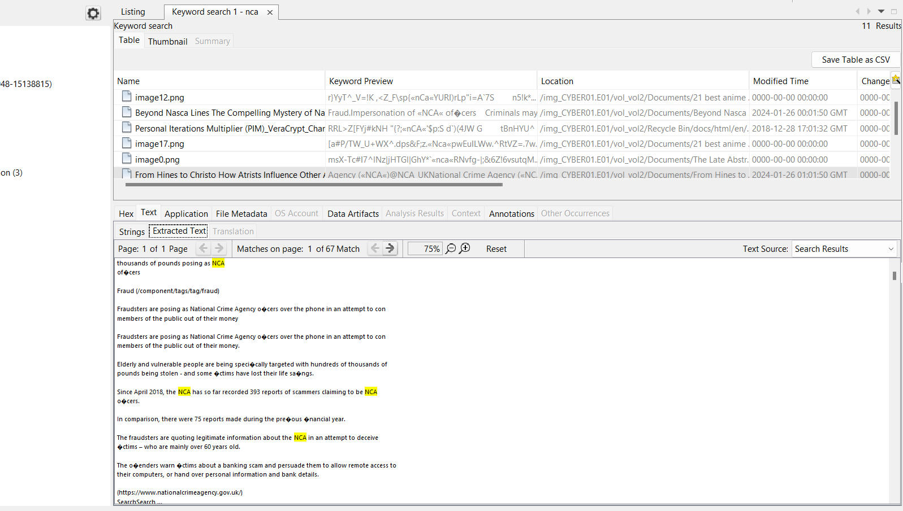

*The Autopsy search results and extracted text show the NCA impersonation references.*

## 7. Identify a file that might be encrypted

In Autopsy's **Encryption Suspected** results, I found `SupperMoon.jpg` in the `Pictures` folder. It was **524,288,000 bytes (500 MiB)** and had a reported entropy of **8.000000**.

The `.jpg` extension suggested an image, but the size and high entropy made it worth testing as a container. High entropy by itself is not proof of encryption, so I treated this as a lead until I could mount the file.

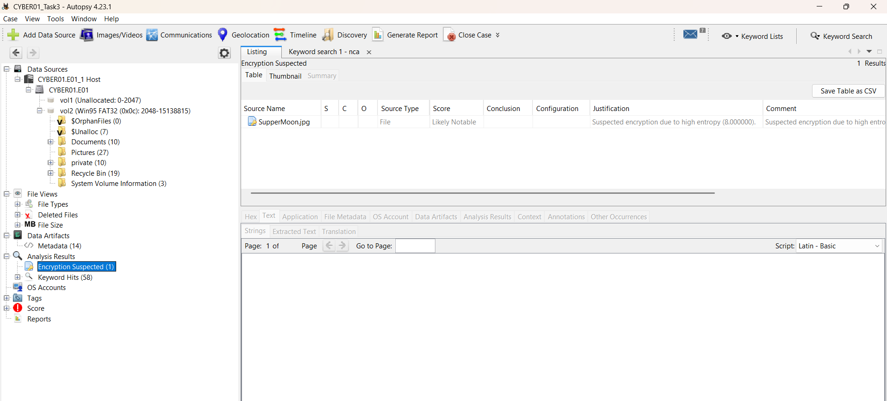

*Autopsy flags `SupperMoon.jpg` for suspected encryption.*

## 8. Export and mount the container

I used **Extract File(s)** in Autopsy to export `SupperMoon.jpg` to the case's `Export` directory. Windows file properties confirmed its size. I then selected the extracted file in **VeraCrypt**, supplied a SHA256-derived password candidate and mounted the outer volume as drive **`X:`**.

The successful mount showed a volume of approximately **499 MiB** in VeraCrypt. I worked from the extracted copy, so this did not alter the source E01 image.

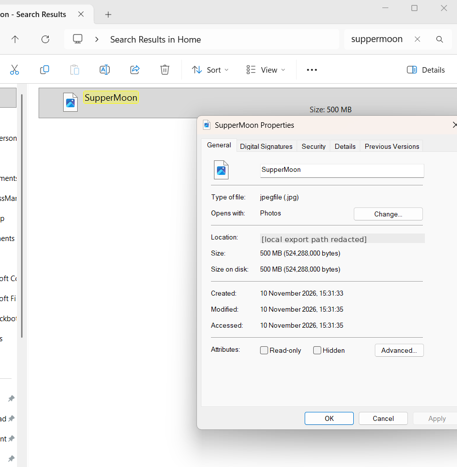

*Windows shows the exported file as a JPG with a size of 500 MiB. The local path is redacted.*

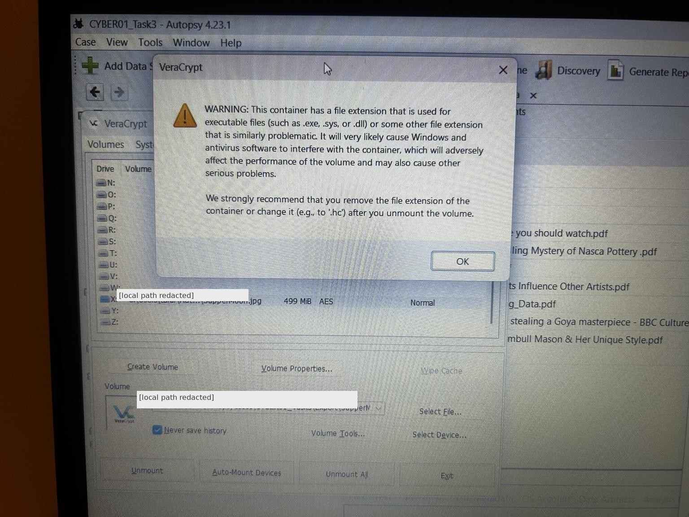

*VeraCrypt shows the mounted `X:` volume, AES and the approximately 499 MiB capacity.*

## 9. Generate a hash from filename text

The access method involved hashing the **filename string**, not the contents of a PDF. I used **Windows PowerShell** to generate a lowercase SHA256 value from UTF-8 text. The command in my captured screenshot uses this candidate:

```powershell
$name = 'CryptographicHashFunctions.pdf'
$sha = [System.Security.Cryptography.SHA256]::Create()
$bytes = [System.Text.Encoding]::UTF8.GetBytes($name)
[BitConverter]::ToString($sha.ComputeHash($bytes)).Replace('-', '').ToLowerInvariant()
```

This returns a 64-character hexadecimal value. I have redacted the output because a hash used to unlock an encrypted container functions as a credential.

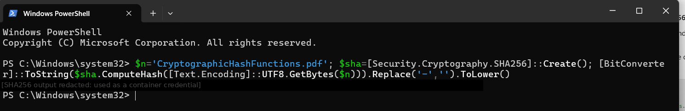

*The captured PowerShell command hashes the UTF-8 filename. The credential output has been removed.*

**Evidence discrepancy:** my later written report names `Twofish_encryption.pdf` as the successful candidate, while the original PowerShell screenshot above uses `CryptographicHashFunctions.pdf`. The screenshot proves the calculation method, but does not independently prove which candidate unlocked VeraCrypt. I would need a confirmed original session record or a repeatable mount test to settle that detail. I have not presented either candidate as verified here.

## 10. Examine the mounted files

I opened `X:` in **Windows File Explorer**. Before creating any recovery output, it contained three original files:

| File | Size shown in Explorer |
| --- | ---: |
| `Ajin-4.jpg` | 176 KB |
| `Blue_Eye_Samurai_DVDCover.jpg` | 279 KB |
| `income.xlsx` | 11 KB |

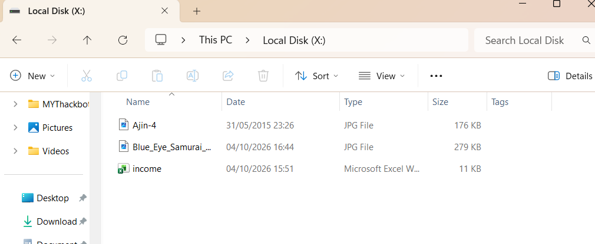

*The initial mounted directory shows the three files and their displayed sizes.*

I opened `income.xlsx` in **Excel** and counted **21 collectors** in rows 2 to 22. The totals row showed **£11,362**. I did not treat that total as proven criminal proceeds, because the workbook alone does not establish the source or legitimacy of the money.

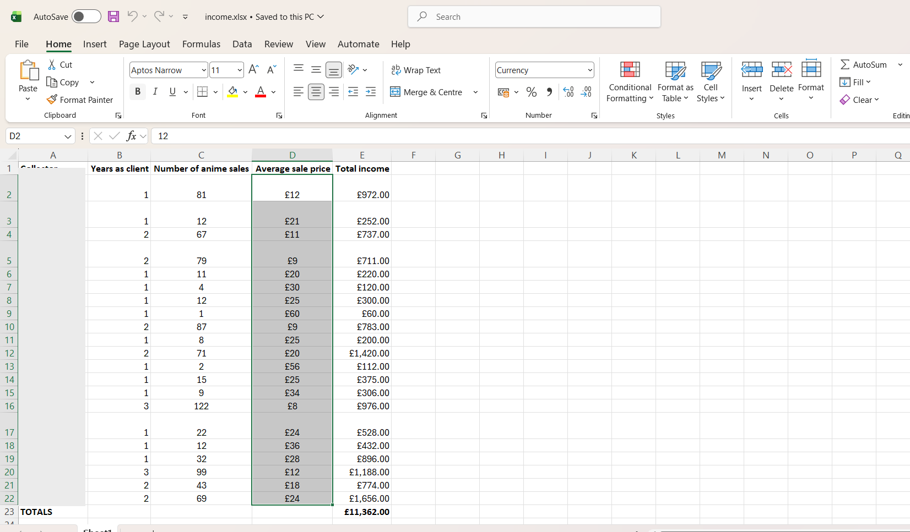

*Rows 2 to 22 contain the collector records. The names are redacted, but the row numbers and total remain visible.*

## 11. Find an archive hidden inside a JPG

I opened `X:\Blue_Eye_Samurai_DVDCover.jpg` in **HxD** and examined the hexadecimal data near the end of the file. At approximately **offset `0x436B5`**, I found bytes beginning `37 7A BC AF 27 1C`, the signature of a **7-Zip archive**.

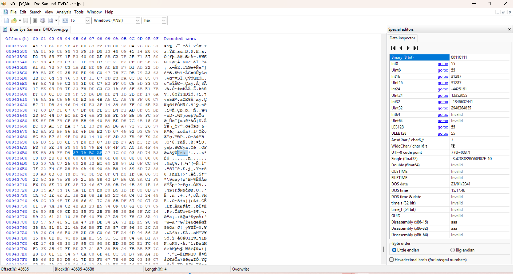

*The highlighted `37 7A BC AF` bytes are the start of the 7-Zip header, with the remaining signature bytes immediately after them.*

I carved the trailing archive data from that point and saved it as `Hidden.7z`. Opening the recovered archive with **7-Zip** showed a file named `Movie.xlsx`.

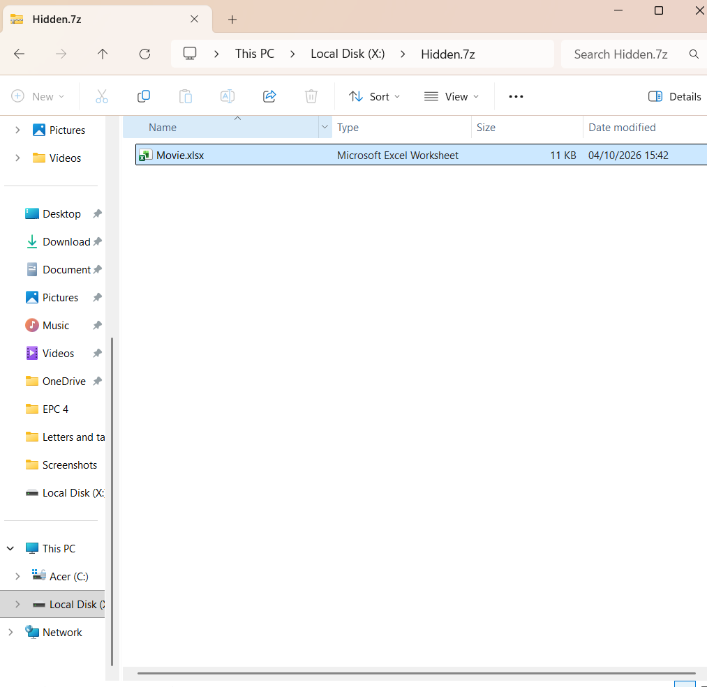

*The recovered `Hidden.7z` archive contains `Movie.xlsx`.*

I created `Hidden.7z` during the investigation, and the screenshot shows it inside `X:`. It was **not one of the original three files**. In a more controlled repeat of this process, I would save carved output to a separate analysis directory rather than writing it into the mounted working copy of the container.

## 12. Interpret the recovered spreadsheet

I opened `Movie.xlsx` in **Excel**. `Sheet1` and `Sheet2` were empty, while `Sheet3` contained **11 entries in rows 41 to 51**, with a totals row beneath them. The columns included `Movie Title`, `Territory`, `Main Contact`, `Sales 2023` and `Sales 2024`.

Several supposed titles, including `Charlie`, `Rocks`, `Crystal`, `Horse`, `E`, `Mary J`, `Speed`, `Special K` and `Lucy`, can also be used as drug street names. Combined with territories, contacts, sales figures and the effort to conceal the workbook, this raised the possibility of coded sales records.

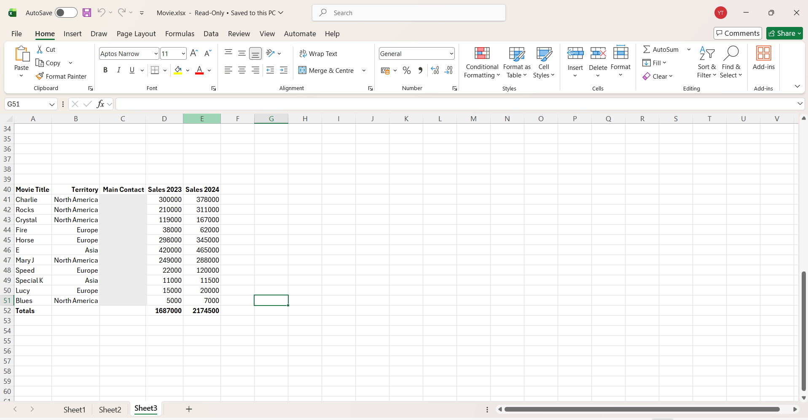

*Sheet3 shows 11 entries and the sales columns. Contact names are redacted for public sharing.*

I cannot conclude from this spreadsheet alone that drugs were sold. The names may have other meanings, and there are no verified transactions, communications or attribution records in the published evidence. My finding is **suspicious concealment and potentially coded records**, not proof of a particular offence.

## What I would verify next

I would confirm which filename-derived hash actually unlocked the container, preserve any future carved output outside the mounted evidence copy, and check the USB subfolders before describing a device-wide file count. If the records were part of a real investigation, I would also seek independent transaction and communication evidence before drawing conclusions about criminal activity.

The original disk images, passwords, recovered workbooks and unredacted screenshots are deliberately not included in this public portfolio.